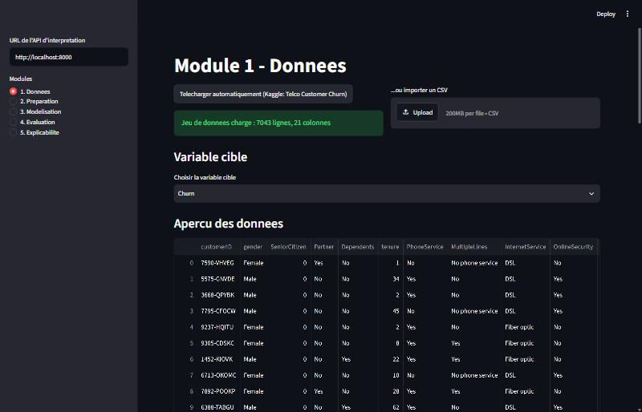
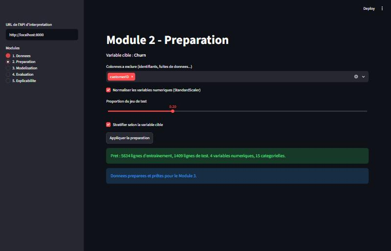
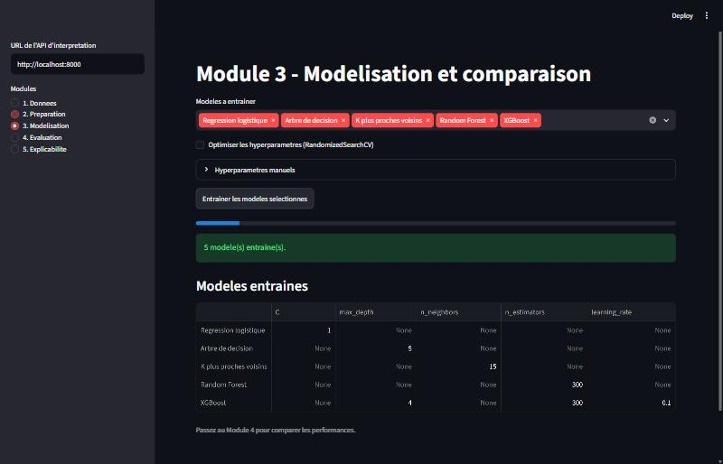
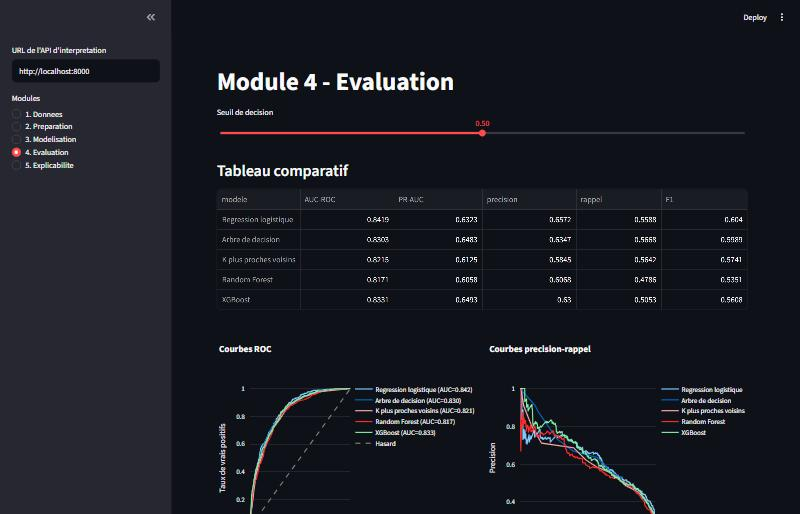
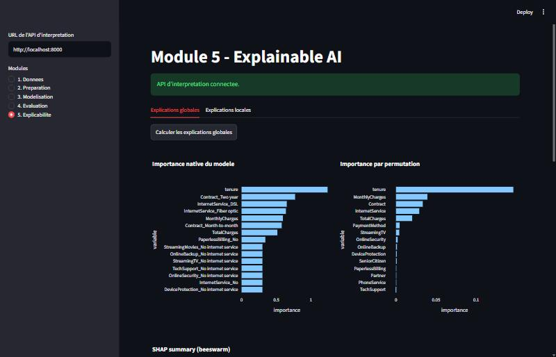
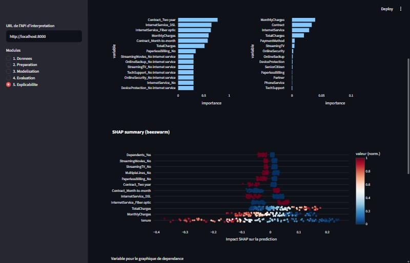
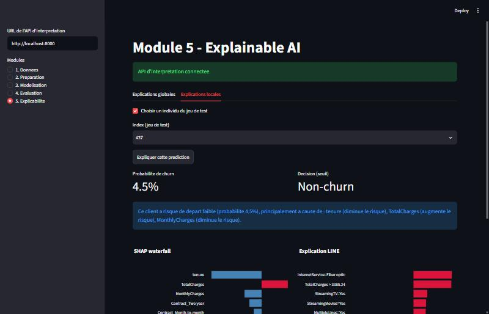
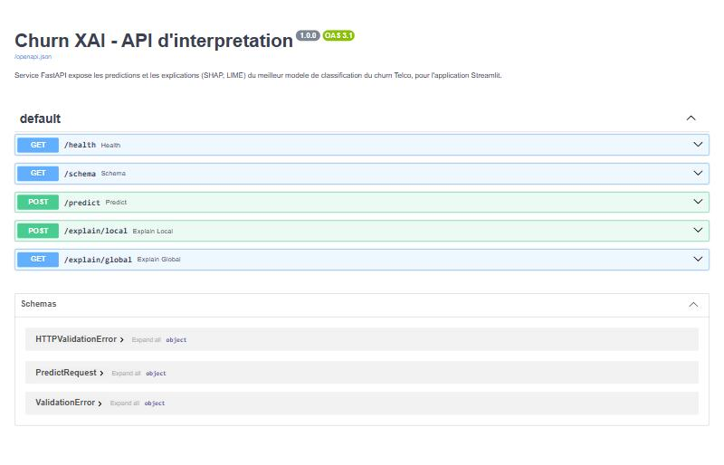

# Churn XAI — Application Web Interactive de Classification Explicable

**Projet Challenge 1** — Data Mining, Filières II3-IA & II3-IF, ENSI, 2026-2027
Cas métier : **Télécom — Attrition client** (Telco Customer Churn, IBM/Kaggle)

**Démo en ligne :** _[lien Streamlit Community Cloud / Hugging Face Spaces — à ajouter après déploiement]_
**API en ligne :** _[lien de l'API FastAPI déployée — à ajouter après déploiement]_

---

## 1. Problème métier

Un opérateur télécom veut anticiper quels clients vont résilier leur abonnement (*churn*) pour
cibler des actions de rétention avant qu'il ne soit trop tard. Le modèle doit être non seulement
performant, mais aussi **explicable** : l'équipe marketing doit comprendre *pourquoi* un client
donné est jugé à risque, pour agir avec les bons leviers (changement de contrat, support technique,
remise tarifaire...) plutôt qu'au hasard.

## 2. Données

- **Source :** [Telco Customer Churn](https://www.kaggle.com/datasets/blastchar/telco-customer-churn)
  (IBM / Kaggle), téléchargé automatiquement via `kagglehub` (ou import CSV manuel).
- **Taille :** 7 043 clients, 21 colonnes (20 variables + `Churn`).
- **Cible :** `Churn` (Yes/No) → encodée en binaire (1 = résiliation).
- **Déséquilibre des classes :** ~26,5 % de churn / ~73,5 % de non-churn.
- **Piège classique du jeu de données :** `TotalCharges` est stocké comme texte avec des valeurs
  vides pour les nouveaux clients (tenure = 0) → converti en numérique avec gestion des NaN.

## 3. Architecture de l'application

```
churn-xai-app/
  app.py                 # Streamlit : navigation entre les 5 modules
  src/
    data.py               # Module 1 — téléchargement / import, aperçu, class balance
    prep.py               # Module 2 — split num/cat, ColumnTransformer, train/test split
    models.py             # Module 3 — registre des 5 modèles + RandomizedSearchCV
    evaluate.py           # Module 4 — métriques, ROC/PR overlay, matrice de confusion, seuil
    explain.py            # Module 5/6 — SHAP, LIME, importance native/permutation
    xai_viz.py            # Module 5 — figures Plotly (beeswarm, waterfall, dépendance...)
    export.py             # Module 6 — sérialisation du modèle + échantillons pour l'API
  api/
    main.py               # Module 6 — service FastAPI (predict, explain/global, explain/local)
  models/                 # modèle exporté (créé par le bouton "Exporter ce modèle")
  notebooks/
    churn_analysis.ipynb  # notebook EDA + modélisation + évaluation (version exploratoire)
  screenshots/             # captures d'écran de l'application (ce README)
  requirements.txt
```

L'application Streamlit (modules 1-5) et l'API FastAPI (module 6) sont deux processus séparés :
Streamlit entraîne les modèles en mémoire, exporte le meilleur sur disque (`models/`), et le
Module 5 appelle l'API pour calculer les explications SHAP/LIME (architecture découplée, comme
demandé par le sujet : *"Service FastAPI documenté, appelé par l'application"*).

## 4. Installation et lancement

```bash
python -m venv .venv
.venv\Scripts\activate       # Windows (ou source .venv/bin/activate sous Linux/Mac)
pip install -r requirements.txt

# Terminal 1 — application Streamlit
streamlit run app.py

# Terminal 2 — API d'interprétation (nécessaire pour le Module 5)
uvicorn api.main:app --port 8000
```

Ouvrir http://localhost:8501 pour l'application, http://localhost:8000/docs pour la doc API.

### Téléchargement des données

Le bouton "Télécharger automatiquement" utilise `kagglehub.dataset_download("blastchar/telco-customer-churn")`.
Cela nécessite une authentification Kaggle (fichier `~/.kaggle/kaggle.json` avec votre clé API,
téléchargeable depuis kaggle.com/settings). Sans cette configuration, utilisez le bouton
d'import CSV manuel (téléchargez le CSV depuis Kaggle et importez-le — l'import CSV avec indication
de la variable cible est explicitement autorisé par le sujet).

## 5. Les 6 modules

### Module 1 — Données
Téléchargement automatique, aperçu, statistiques descriptives, valeurs manquantes, proportion de
classes, visualisations exploratoires interactives (distributions, corrélations, taux de churn par
variable).



### Module 2 — Préparation
Choix de la cible et des variables, exclusion des identifiants, imputation + encodage one-hot +
normalisation (`ColumnTransformer` réutilisable dans chaque pipeline de modèle), split
entraînement/test paramétrable avec stratification.



### Module 3 — Modélisation et comparaison
5 modèles : régression logistique, arbre de décision, k-NN, Random Forest, XGBoost. Hyperparamètres
réglables manuellement ou optimisés automatiquement (`RandomizedSearchCV`, scoring ROC-AUC).



### Module 4 — Évaluation
Tableau comparatif (AUC-ROC, PR-AUC, précision, rappel, F1), courbes ROC et précision-rappel
superposées, matrice de confusion par modèle, curseur de seuil de décision avec effet en direct.



**Résultats obtenus** (seed=42, split 80/20 stratifié, hyperparamètres par défaut) :

| Modèle | AUC-ROC | PR-AUC | Précision | Rappel | F1 |
|---|---|---|---|---|---|
| **Régression logistique** | **0.842** | 0.632 | 0.657 | 0.559 | 0.604 |
| XGBoost | 0.833 | 0.640 | 0.630 | 0.505 | 0.561 |
| Arbre de décision | 0.830 | 0.648 | 0.535 | 0.567 | 0.599 |
| K plus proches voisins | 0.822 | 0.613 | 0.585 | 0.564 | 0.574 |
| Random Forest | 0.817 | 0.606 | 0.607 | 0.479 | 0.535 |

La régression logistique l'emporte légèrement sur ce jeu de données — un modèle simple suffit
déjà, ce qui plaide en faveur de l'option la plus interprétable (voir section 7).

### Module 5 — Explainable AI
**Explications globales** (via l'API) : importance native du modèle, importance par permutation,
SHAP summary (beeswarm), graphique de dépendance SHAP.




**Explications locales** : sélection d'un individu du jeu de test (ou saisie manuelle), probabilité
et décision, SHAP waterfall, explication LIME, phrase de synthèse générée automatiquement.



### Module 6 — API d'interprétation (FastAPI)
Service documenté (OpenAPI/Swagger), appelé par le Module 5 :

| Endpoint | Description |
|---|---|
| `GET /health` | état du service et du modèle chargé |
| `GET /schema` | colonnes attendues + exemple de ligne |
| `POST /predict` | `{"features": {...}}` → probabilité + décision |
| `GET /explain/global` | importances natives, par permutation, valeurs SHAP sur échantillon |
| `POST /explain/local` | `{"features": {...}}` → SHAP waterfall, LIME, phrase de synthèse |



## 6. Notebook

[`notebooks/churn_analysis.ipynb`](notebooks/churn_analysis.ipynb) reproduit le pipeline complet
(EDA → préparation → entraînement des 5 modèles → évaluation → SHAP) de façon linéaire, pour
inspection rapide sans lancer l'application.

## 7. Analyse critique (voir aussi le one-pager)

- **Cohérence SHAP/LIME :** sur les individus testés, SHAP et LIME s'accordent sur le signe et
  l'ordre des principales variables (`tenure`, `Contract`, `InternetService`), ce qui renforce la
  confiance dans l'explication. Une divergence serait un signal d'instabilité du modèle local
  à investiguer.
- **Variables sensibles :** `gender` et `SeniorCitizen` figurent dans le jeu de données et sont
  utilisées par le modèle ; leur importance (native et par permutation) reste cependant faible
  comparée à `tenure` ou `Contract`. Un déploiement réel devrait tester l'équité du score par
  sous-groupe avant mise en production.
- **Compromis performance/interprétabilité :** la régression logistique égale voire dépasse
  XGBoost sur ce jeu de données (AUC 0.842 vs 0.833) — il n'y a donc pas de sacrifice de
  performance à choisir le modèle le plus interprétable ici.
- **Actions concrètes :** `tenure` faible + `Contract` mensuel + `InternetService=Fiber optic`
  ressortent comme les signaux dominants de risque — ces clients sont les cibles prioritaires pour
  des offres de fidélisation (passage à un contrat annuel, remise les premiers mois).

## 8. Déploiement

- **Application Streamlit :** à déployer sur [Streamlit Community Cloud](https://streamlit.io/cloud)
  ou [Hugging Face Spaces](https://huggingface.co/spaces) à partir de ce dépôt (`app.py` comme
  point d'entrée, `requirements.txt` fourni).
- **API FastAPI :** à déployer séparément (Hugging Face Spaces en mode Docker, Render, Railway...)
  et à référencer dans l'app via le champ "URL de l'API d'interprétation" de la barre latérale.

## État d'avancement

- [x] Module 1 — Données
- [x] Module 2 — Préparation
- [x] Module 3 — Modélisation et comparaison
- [x] Module 4 — Évaluation
- [x] Module 5 — Explainable AI (SHAP, LIME)
- [x] Module 6 — API FastAPI
- [ ] Déploiement cloud (Streamlit Community Cloud / HF Spaces)
- [ ] One-pager PDF — voir [`one_pager.pdf`](one_pager.pdf)
